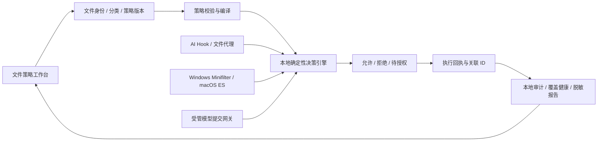

# 文件策略：让 AI 用好文件，也守住文件边界

版本：方案 / 交互原型 v2，2026-11-11。目标：Network Lens 安全中心参赛模块。本文为拟建设方案，原型数据全部模拟，不代表系统防护已实现。

## 1. 产品结论与参赛表达

把“文件黑名单配置”升级为**面向任务的文件使用权限中心**：用户选择项目或办公目录，系统推荐策略；按“谁、哪个文件、做什么、发到哪里”决定允许、阻止或单次授权；每次决定都能解释、核验、撤销。

对外一句话：**让 AI 看得到该看的、改得动该改的，敏感内容出门前再过一道关。**

三项可证明的亮点：

1. **同一文件，按主体与动作区别保护。** IDE 可以改源码，受管 AI 可以读源码，私钥不交给 AI；Excel 正常编辑薪资表，发送到外部模型需要另行授权。读取许可不隐含外发许可。
2. **不牺牲任务完成。** 拦截后提供脱敏副本、限定一次的授权、可信工具重试，不把“全局关闭防护”当恢复工作的路径。
3. **保护有证据。** 分开呈现策略版本、执行端接收、生效验证、操作回执。没有接入的通道直接显示“未覆盖”，不使用虚假的 100% 安全分。

参赛重点应是“不同权限的可解释决策 + 任务继续完成 + 有证据的恢复闭环”；系统级防护作为增强层单独展示成熟度。

## 2. 当前项目事实与衔接

本次以当前工作区为准，已有大量未提交开发；本交付仅新增文档、独立原型与验证脚本，不改现有运行代码。

| 当前位置 | 已有行为 | 与新方案的关系 |
| --- | --- | --- |
| `src/FileProtection.tsx` | 选目录、敏感候选、读取/修改/发送模型独立配置、策略自检、审计预览 | 保留使用模型，改为统一策略工作台 |
| `electron/core/file-policies.ts` | 元数据枚举；默认上限 10,000 条目、500 候选、12 层、10 秒；跳过符号链接等；明确 `canBlockToolAccess: false` | 作为资产发现与旧策略迁移入口，不能标为实际防护 |
| `electron/security/guard-protocol.ts` | AI 操作执行前规则，读凭据、写保护路径等检查；项目级例外 | 接入统一引擎，逐步替换基于命令文本的推断 |
| `electron/security/center.ts` | 策略保存、工具配置状态、真实钩子事件、审计链；例外按规则和项目保存 | 接入执行端版本回执；现有无到期项目例外迁移成待复核，不默认为单次权限 |

当前“文件策略”与“操作规则”不可各自维护相互矛盾的许可。新架构只有一个策略决策源，各适配器消费同一编译版本。现有行为是源代码检查结论，本次未对真实系统防护做运行验证。

## 3. 两类人群、两套起点、一套权限模型

| 使用者 / 文件 | 正常工作默认 | 需要阻止或确认 | 不打扰的设计 |
| --- | --- | --- | --- |
| 开发：源码 / 测试 | 受管 AI 可读；项目内修改可允许并形成 diff | 删除、项目外写、发布配置改动需确认 | 忽略构建缓存噪声；按任务聚合通知 |
| 开发：`.env`、SSH 私钥、云凭据 | 可信专用凭据消费者按精确用途使用 | AI / 未知进程读写或外发默认禁止 | 引导使用 `.env.example`；不能放行整个 Python、Node、Shell |
| 开发：部署脚本 / Git hooks | 可读、改动确认 | 持久化植入、删除或替换阻止 | 显示具体路径和前后变更，确认不扩展到整个仓库 |
| 办公：合同 / 报价 / 薪资表 | 已验证身份的 Word、Excel、WPS 本地编辑允许 | 未知应用读取、AI 外发、批量删除按级别处理 | 自动保存、临时文件、另存为与原子替换纳入同一文档任务 |
| 办公：AI 摘要 / 周报 | 先看本地脱敏结果，再向已知目标发送副本 | 原文敏感字段、未知模型目的地禁止或确认 | 一次确认清楚说明文件、字段、目的地、次数 |
| 办公：网盘 / 邮件 / 浏览器 | 显示当前已覆盖渠道 | 未接入渠道不能声称阻断附件、剪贴板、打印与截屏 | 明确单独接入入口，避免重复索取权限 |

模板是可审阅的起点，不根据“职业”自动扫描整个主目录。办公模板首先推荐用户选 Documents/指定业务文件夹；开发模板推荐具体仓库及显式选择的凭据路径。

文件发现分两级：① 默认只枚举名称、类型、大小，结果叫“敏感候选”；② 用户明确选择后本地扫描正文，使用确定性规则/格式解析识别凭据或个人信息，显示命中类型、位置与置信度，不把正文送到云端。加密、损坏、超大或云端占位文件显示“未检查”，不判为无敏感内容。

## 4. 技术架构：统一决策，三层执行



### 4.1 L1：受管 AI 操作层，优先落地

复用当前 Hook，优先检查工具提供的结构化文件路径与操作类型；增加文件代理接口，读取、修改、删除、重命名都先决策。命令解析只作补充，不能证明任意脚本没有访问敏感文件。

主体由执行端确认：用户身份、工具适配器、会话、进程出生时间与父子链；请求里自称“可信 IDE”不能构成证据。通用解释器允许列表必须绑定受管任务、脚本身份与范围；仅进程名称、父进程或签名均不能独立作为完全可信依据。

适用于可接入的 Codex/Claude 等工具时，逐版本列能力；不预设所有插件、子进程、MCP、远程会话都经过同一 Hook。无完整拦截点的适配器只标记“部分操作覆盖”。

### 4.2 L2：操作系统文件保护，Windows/macOS 分别实施

| 维度 | Windows 方案 | macOS 方案 |
| --- | --- | --- |
| 执行点 | 签名 Minifilter + 本地服务；按支持范围注册 create/read/write/set-information 等回调 | Endpoint Security 系统扩展；对支持的 OPEN/CREATE/RENAME/UNLINK 等 AUTH 事件决策，NOTIFY 辅助记录 |
| 关键限制 | 各 I/O 路径、缓存、内存映射与分页 I/O 要专项验证；不能只拦一次打开就宣称完整写保护 | 不存在通用的“每次 read/write 都弹窗”能力；已打开句柄、mmap 与事件支持范围须实测并明确边界 |
| 发布门槛 | 管理员安装、驱动签名与目标版本兼容；按 Microsoft 当前发布流程安排测试与签名 | ES entitlement、签名/公证、系统扩展批准、Full Disk Access；权限缺失不能显示已保护 |
| 原生能力定位 | Defender Controlled Folder Access 可作为可选写保护辅助，不能当作任意文件禁读或防模型外发 | TCC/FDA 决定访问资格，不是产品级的按文件、按 AI 动作授权策略 |
| 本机身份 | 卷标识 + File ID + 文件版本；签名验证、SID、进程身份 | volume + inode/file identity + 版本；audit token、Team ID/signing ID、签名状态 |
| 路径适配 | 大小写特性、盘符/UNC、reparse point/junction、硬链接、ADS、长路径 | 卷大小写敏感性、Unicode 文件名、symlink/hardlink、APFS 文档替换 |
| 日常办公 | 验证 Office/WPS 自动保存、临时文件→替换、OneDrive 已落地文件 | 验证 Office/WPS/Pages 自动保存、iCloud 已落地文件、Finder 重命名 |

Microsoft 官方描述了 Minifilter 前置回调及提前终止 I/O 的机制；这给出可行执行点，并不自动完成所有文件路径的保护。[前后置回调](https://learn.microsoft.com/en-us/windows-hardware/drivers/ifs/writing-preoperation-and-postoperation-callback-routines)、[终止 I/O](https://learn.microsoft.com/en-us/windows-hardware/drivers/ifs/completing-an-i-o-operation-in-a-preoperation-callback-routine)。生产驱动需要按当前签名政策处理。[驱动签名政策](https://learn.microsoft.com/en-us/windows-hardware/drivers/install/kernel-mode-code-signing-policy--windows-vista-and-later-)。

Apple 官方区分 AUTH 与 NOTIFY，AUTH 要在每条消息期限内响应；ES 提供文件相关授权机制，网络能力需另行处理。**不得挂起系统 I/O 等待用户思考**：立即拒绝当前动作→发出用户通知→授权后重新发起。缓存随策略或临时权限失效处理，单次授权不使用扩大权限的缓存。[Apple ES 架构说明](https://developer.apple.com/videos/play/wwdc2020/10159/)。客户端要求 entitlement 与 FDA。[创建 ES 客户端](https://developer.apple.com/documentation/EndpointSecurity/es_new_client%28_%3A_%3A%29)。不要把某个旧版本的超时行为当成所有目标版本的保证，必须实测各支持系统。

Defender CFA 的目标是阻止不可信应用修改受保护目录，不提供这里所需的模型提交判断。[CFA 官方配置](https://learn.microsoft.com/defender-endpoint/enable-controlled-folders?view=o365-worldwide)。

首版系统级承诺限定为**经验证的本地卷、操作类型和应用版本**；WSL、容器、远程开发、SMB/NFS、云端占位文件按独立执行环境处理，没有执行端就显示未覆盖。不能通过简单 `chmod` 或修改 DACL 区分同一用户的 IDE 与 AI。

### 4.3 L3：模型提交关口，让“可读”和“可发”真正分开

读取之后再限制发送，只对**经过受管提交通道**的请求可验证。网关必须拿到最终序列化请求与附件，完成字段识别、策略判定、目标验证后才发出；修改请求体后重新判定。每次提交绑定文件版本/内容摘要、目标域名与模型、策略版本、一次性 request ID。

首版优先实现本产品发起的附件/上下文提交链。第三方模型调用若不经过该关口，则外发能力明确显示未覆盖。单靠“某进程读过文件”和“随后联网”只能得到关联风险，不能证明它上传了该文件。TLS 下的网络地址观测也不能证明请求正文。

办公脱敏流程：本地解析副本→替换姓名/账号等字段→用户预览→复扫→用户确认目标→只提交该版本副本。原件不变；文件改变后之前的预览与许可失效。扫描器可能漏检，所以文案为“已处理识别出的字段”，不能称“保证无敏感内容”。生产脱敏模块与网关均为新增开发。

## 5. 策略数据与确定性语义

建议新建 `src/shared/file-security.ts`、`electron/security/file-policy-engine.ts`、`file-policy-compiler.ts`、`capability-registry.ts`、`approval-broker.ts`、`disclosure-gateway.ts`；native 程序独立于 Electron renderer。下面是设计契约，不是已有 API。

```ts
type Operation = 'read' | 'write' | 'delete' | 'rename' | 'disclose';
type Decision = 'allow' | 'deny' | 'ask';
type Policy = {
  id: string; revision: number; scopeId: string;
  resource: { identity?: string; relativePattern?: string; classification?: string };
  subjects: { adapter?: string; signer?: string; sessionBound?: boolean }[];
  operations: Partial<Record<Operation, Decision>>;
  destinations?: string[]; // 仅提交关口可以可靠使用
  locked: boolean; requiredCapabilities: string[];
  mode: 'observe' | 'enforce';
};
type Grant = {
  id: string; requestId: string; actorIdentity: string; sessionId: string;
  resourceVersion: string; operation: Operation; destination?: string;
  policyRevision: number; expiresAt: number; usesRemaining: 1;
  reason: string; grantedBy: string;
};
```

### 判定顺序

1. 校验请求真实性与能力。无执行点不产生“允许”回执，而产生 `uncovered`；身份未知按未知主体处理。
2. 归一化资源并验证实际对象，防止路径别名和检查后替换；不能仅靠字符串前缀做目录包含关系检查。
3. 企业锁定拒绝最高优先级；普通适用规则取 `deny > ask > allow`，更具体规则默认不能冲掉上级禁止。界面列出全部命中与最终赢家。
4. 单次权限仅满足当前 `ask`，不能覆盖 `deny`。绑定全部字段，版本/身份/目标变化、到期、使用或撤销即失效。生产实现用事务 CAS 原子消费，防双并发重放。
5. 无匹配规则采用范围模板默认值，明确列出。复合动作分别评估：复制需要源读取+目标写入；重命名需要源与目标检查；模型提交还需要 disclose；已允许读取不抵消外发拒绝。
6. 决策与执行结果分离：`allow` 可能执行失败；`deny` 只有执行端确认已拒绝才计阻断。所有模式共用引擎，observe 仅记录“若强制将拒绝”。

自然语言可帮助生成待确认规则，不参与每次 I/O 的实时放行决定，避免延迟与非确定性。

### 资源身份与任务连续性

目录策略覆盖以后出现的新文件；文件策略绑定对象身份并处理同目录重命名。原子保存会替换 inode/File ID，需验证写入者与替换链后延续文档分类；不因“旧文件没了”自动清掉敏感级别。硬链接映射所有别名；不支持时拒绝将其显示为完整覆盖。校验后操作尽量绑定同一句柄，native 事件使用对应操作对象，不回到不可信路径重新读取。

密钥无需为检测而全文缓存。分类缓存键为文件身份+内容版本+分类器版本；文件变更失效。外发许可绑定最终发送字节摘要。备份只针对经过代理的修改且显式配置；恢复先 diff、校验当前版本、再写入；不承诺撤回已经外发的数据。

## 6. 发布、运行、恢复的完整状态机

```text
草稿 → 试运行 → 待发布 → 下发中 → 执行端已接收 → 探针通过 → 已生效
                      └失败→ 保留上一生效版本 / 显示失败端 / 重试
已生效 → 权限撤销、进程失联或版本不一致 → 部分生效 / 已失效
已生效 → 回滚请求 → 用旧规则创建新修订版 → 同样下发、校验 → 已生效

被拒绝 / 待授权 → 解释原因 → 单次授权或脱敏副本 → 重试 → 执行回执
单次授权 → 已使用 / 已到期 / 已撤销 / 文件变化失效 → 回归原规则
```

- **试运行**：在明确的时间窗口与采集范围内，以相同引擎评估样本；正常编辑/自动保存与高风险样本都要覆盖。展示样本总数、会拒绝/确认/允许数及未覆盖数。历史缺口不能推算全机误拦截率。
- **原子发布**：校验 `expectedRevision`；编译快照→验证能力→执行端 ACK→探针验证。不同执行端不能假装分布式原子切换，UI 逐端显示版本，部分失败保留原版本并记录差异。
- **验证探针**：只访问应用创建的无敏感内容样本；包括该拒绝的路径和应允许的正常操作；探针标记 simulation/self-check，不进入真实风险统计。
- **异常策略**：代理/网关服务不可用时拒绝受保护的访问或提交；系统扩展/驱动缺失时不能宣称仍可拒绝，立即标为覆盖失效。不得为保持界面“绿色”自动放宽规则。
- **离线**：沿用本地最后验证版本；不依赖云端实时判定。审批需在线时保持拒绝；本机授权须可信本地 UI 和用户身份验证。
- **撤销与缓存**：修改策略、到期或撤销时向所有相关执行端失效缓存并记录 ACK；未收到的端显示缺口。不能声称撤销后能收回已打开句柄/已读内容。

## 7. 交互方案

### 页面骨架

模块内五个页签：**保护工作台 / 文件发现 / 任务与验证 / 授权与记录 / 覆盖与健康**。沿用安全中心外壳，独立原型只展示模块内容，不重复设计全局菜单。

首屏回答四个问题：保护哪些范围；哪个通道在工作；哪些操作被阻止；有什么待处理。策略列表把读、改、删、外发拆列；技术名词收在覆盖详情，不要求办公用户理解内核。

### 新建策略

1. **选范围**：开发/办公模板→明确路径→显示候选与发现依据。预览不读取真实文件。
2. **定权限**：主体、操作、去向分别设置；默认不允许把受保护文件外发；允许项有解释；受管 AI 与全部应用是不同覆盖范围。
3. **试运行**：运行示例动作，展示当前与新策略差异、未覆盖项；配置改动后试运行结果失效。
4. **确认发布**：展示影响对象、要求的执行端、旧/新版本、恢复方法；失败保留输入，成功后回到列表显示回执。

### 拦截提示与事件详情

提示使用“哪个应用正在对哪个文件做什么→为什么→怎么继续”顺序。例如：“AI 助手准备发送《薪资汇总.xlsx》到外部模型。命中‘薪资外发需确认’，原件尚未提交。可预览脱敏副本，或仅授权这次提交。”

阻止读取密钥时不提供默认单次放行；推荐脱敏样例配置。仅 `ask` 事件可授权。拒绝通知不呈现秘密原文；同一任务重复事件合并显示次数。系统 I/O 已被拒绝时，明确写“请回原应用重试”，不伪装原动作仍挂起。

事件抽屉展示：请求→资源与主体校验→策略命中→执行回执，含策略版本、适配器、时间、关联 ID。真实阻断、自检、试运行、历史回溯、配置操作分别计数。只看到读取不能推断已外发；无记录不能断言没有访问。

### 放行与恢复

授权表单预填只读的主体、文件版本、操作与目的地；原因必填；默认 1 次 / 15 分钟。授权不是执行；按钮为“授权后重试”，不用“解除保护”。到期由后端裁定，前端倒计时只作展示。受管任务可以幂等重试；非受管办公进程让用户回原应用重试。

权限撤销时顶栏降级并显示具体通道，保留仍工作的 AI 代理；“重新检查”恢复前必须重新取回能力与探针回执。回滚策略也需确认、下发与验证；回滚不删除事件或回滚已经执行的文件操作。

### 角色与隐私

个人模式：本人管理自己的范围与授权。企业模式：员工可看解释、申请授权；审批人审批限定请求；策略管理员发布组织规则；审计员只读。审批页显示权限不足原因，服务端必须再次鉴权。不能用浏览器参数切换真实身份。

## 8. 交付原型及演示路线

入口：`docs/prototype/file-policy/index.html`。单文件原生 HTML/CSS/JS，无依赖网络，不访问真实文件、不安装驱动、不修改系统权限。浏览器本地保存纯演示状态；刷新可继续，可在页尾重置。

原型 v2 新增：文件发现与候选确认、策略发布后候选状态联动、任务完成看板、安全样例替代路线、文件版本/目标变化使许可失效、执行失败与重试、原始请求与后续处理关联。

原型实现：Windows/macOS 路径切换、开发/办公模板、策略详情与四步创建、试运行、发布成功/失败重试、版本回滚、场景决策、临时授权一次性消费/到期/撤销、脱敏副本预览、覆盖丢失与恢复、搜索与清空、事件详情及实际下载 JSON 演示报告。

建议 3 分钟演示：

| 时间 | 动作 | 评委能看到的价值 |
| --- | --- | --- |
| 0:00–0:35 | 开发模式，验证源码读取和密钥读取 | 正常工作放行，危险读取拒绝，原因可解释 |
| 0:35–1:20 | 办公模式，外发薪资，预览脱敏副本再提交 | 原件不动，任务继续，读与发分离 |
| 1:20–1:50 | 合同外发需确认，授权一次再重试，再试一次 | 第一次许可被消费，第二次重新询问 |
| 1:50–2:20 | 非受管终端读密钥：先未覆盖；启用系统增强的模拟能力后再次验证 | 明确展示增强层补上了什么能力 |
| 2:20–3:00 | 新建策略→试运行→发布；模拟权限撤销→降级→恢复；查看证据 | 配置与实际生效闭环，而非只有开关 |

界面全程标注“交互原型 · 模拟数据”，导出的报告同样标注。真实比赛若缺少系统扩展签名/授权，应只演示已验证的 L1/L3，并将 L2 单列为方案演示。

## 9. 实施顺序与验收

以下为建议工作包，不是已完成承诺或固定工期。

| 阶段 | 工作 | 可接受的验收证据 |
| --- | --- | --- |
| P0 统一语义 | 统一策略模型、迁移现有文件规则、冲突解释、例外到期、版本状态 | 决策用例、迁移前后对比、并发与过期测试 |
| P0 比赛闭环 | 接一个真实 Hook/文件代理、接本产品提交关口、发布探针、审计和撤销 | 无敏感样本的真实拒绝/允许回执；第二次重放拒绝；网关无发送证明 |
| P1 办公可用 | 本地文档分类、脱敏副本、Office/WPS 保存链、信任工具身份 | 文档可正常保存；敏感副本字段处理；原件摘要不变 |
| P1 系统增强 | macOS ES 授权流程、Windows Minifilter、支持矩阵 | 两平台真机测试；服务崩溃/卸载/升级/撤权后状态真实；I/O 兼容验证 |
| P2 企业扩展 | 组织策略、审批、远端审计锚、渠道扩展 | RBAC、离线与同步冲突、远程回执与审计完整性 |

建议测量目标（待实测）：本地热路径决策 p95 < 10ms；受管提交安全预检 p95 < 100ms（不含大文件解析）；常见 IDE/Office 保存耗时增量 p95 < 5%。不同文件大小、冷缓存与批量操作分桶报告，不能用原型定时器当性能证据。

必验场景：正常读写、凭据拒绝、复制/重命名/原子替换、相对路径和 `..`、符号/硬链接、Windows 路径别名/ADS、已有句柄/mmap、PID 重用、解释器子进程、目标改变、文件版本改变、两请求并发消费单次许可、到期/重启/时钟回拨、策略版本冲突、磁盘满/审计失败、系统权限撤销、网关绕过、远程/云端占位未覆盖。

审计采用追加写、脱敏字段和哈希链，敏感原文不入日志。链只能检测部分修改，不能独立证明本机管理员未重写全链；企业版可引入设备密钥签名与远端锚定。若审计失败：受管敏感操作按配置拒绝；native 热路径不得阻塞等待云端，使用有界队列并明确暴露丢失与失效状态。

## 10. 设计标注与范围

依据 security-console-design：内容容器 16px、面板 24px、间距 16px、圆角 8px、12 栅格；标题/正文/注释分层；品牌采用科技绿预览 token，状态使用独立红/橙/蓝/绿；所有状态附文字。无外部图片与品牌图标，使用文字与 CSS 装饰；非正式品牌验收。

首页为概览，策略/记录列表为模式 B（统计独立、不受搜索筛选影响）；搜索需提交，清空只改待提交条件。表格行高 48px、横向滚动、首列/操作列冻结；详情抽屉 880px，短授权/确认对话框 560px；弹层标题与操作区固定、中间滚动。原型选择标签置顶表单，适应单文件演示及窄屏，这是相对规范横向标签布局的明确偏离。

1920/1440/1366/1280 使用自适应双列；小于 1100 主区单列；小于 768 控制条换行、表格内部横向滚动，弹层不超出视口。弹层支持 Escape、焦点约束与恢复；未保存离开要确认。覆盖加载、空、失败/重试、成功、禁用、确认状态。

真实已验证范围与原型操作检查结果见同目录原型 README；未经验证的两平台原生实现、模型网络出口与真实权限安装不能作为已实现成果。


## 11. v2 产品收敛：从权限配置走到任务完成

### 产品特点如何被用户感知

核心定位是“本机 AI 文件使用权限管家”。普通用户围绕工作任务理解文件权限，开发者可进一步查看路径、执行端和请求证据。首页先给下一步行动、再给范围和规则，不要求用户先学安全术语。

| 产品特点 | 用户看到什么 | 闭环条件 |
| --- | --- | --- |
| 保护有依据 | 元数据候选显示发现理由，由本人确认用途 | 发布后才显示已配置；撤回或回滚后重新计算 |
| 权限够精确 | 同文件按主体及读/改/删/外发区别处理 | 读取不自动授权模型提交；原件与副本分别判定 |
| 工作能继续 | 单次许可、脱敏副本、不含秘密的样例配置 | 后续动作关联原始请求，保留原保护规则 |
| 授权不会失控 | 展示文件版本、目标、策略修订和一次使用 | 任一条件变化、到期、使用、撤销均不可复用 |
| 生效能证明 | 显示决策、通道与执行回执 | 允许但失败不能标任务完成；无覆盖不能标安全 |

推荐比赛开场：“AI 能帮助我们处理文件，但用户仍应掌握文件怎么被使用。这里既能保护密钥，也能让合同、报表的分析继续完成，而且每一步都有可核验的结果。”

### 三条完整任务路径

**开发任务：生成配置加载代码。** AI 请求生产凭据 → 禁止读取 → 展示命中理由 → 推荐 `.env.example` → 使用只包含字段结构的样例继续 → 返回完成回执 → 原凭据保持禁止。禁止读取本身算保护结果，使用安全材料完成代码任务才算业务结果；两者分开计数。

**办公任务：分析薪资分布。** 原表在受管本地处理 → 提交前询问 → 用户预览去标识副本 → 清楚说明仍保留工资/部门 → 用户确认本次目的地 → 再校验副本与请求 → 执行回执 → 任务完成。用户不认可剩余字段时取消，不外发；去标识副本并不等于匿名数据或绝对安全。

**发布任务：AI 修改配置。** 当前操作先拒绝执行并请求确认 → 用户核对具体文件和动作 → 授权一次 → 重新发起并再次核对版本 → 原子消费许可 → 执行成功则完成；执行失败则保持任务未完成，展示失败回执。许可不自动返还，防止失败后的重复执行扩大风险；生产修改需按执行 ID 查询结果，确认未提交后才进行幂等重试。

### 文件发现状态不能冒充保护状态

```text
未扫描 → 元数据候选 → 本人确认用途 → 选择保护模板 → 草稿/试运行 → 发布验证
                 └暂缓确认 → 重新纳入
发布验证通过 → 已配置策略 → 按所需通道分别展示就绪/未就绪
规则回滚或移除 → 重新计算文件策略状态，不能沿用旧“已保护”标签
```

原型 v2 中“确认并设置保护”只预填推荐规则，不会跳过试运行和发布；扫描不擅自读取正文、自动上传、或全盘添加文件。开发凭据推荐拒绝读写外发；办公资料推荐本地读取允许、修改确认、外发确认。用户暂缓后仍可以恢复，暂缓不代表该文件无风险。

### 授权与副本必须绑定请求快照

请求快照至少包含：真实主体、会话、文件对象与版本、动作、最终目的地、策略修订。原型采用固定样例身份和可变化的版本；生产必须使用不可由 renderer 自报的执行端身份及内容摘要。

- 文件更新：之前的询问记录不能再生成旧授权；已创建许可失效；脱敏预览必须重做。
- 目的地切换：之前确认 model A 的许可不得提交给 model B；新请求重新提示。
- 策略变化：重跑规则；旧试运行不能发布；草稿带 expectedRevision 防覆盖。
- 授权消费后执行失败：显示“规则允许 / 执行失败 / 任务未完成”；不自动返还许可。
- 后续动作关联：原始询问记录可查看授权、重试、替代材料与副本提交；历史判定保持原貌，不把旧“询问”改写为“允许”。

原型已落实文件版本、目的地、策略版本检查及后续记录链接。副本处理依然是示例数据模拟；生产还需任务会话、模型接收请求回执与幂等机制。

### 比赛效果与实现证据的界线

首页采用四段产品路径：“发现与确认 → 按任务授权 → 安全继续工作 → 核验与恢复”。展示正常工作与风险操作对照，避免用大量红色告警替代产品价值。

计数分别使用：候选待确认数、已配置规则数、就绪通道数、模拟阻止数、待使用许可数。任务完成只来自完成回执。未覆盖、不完整扫描、规则评估、受管提交和原生系统操作均不能混用统计口径。

原型 v2 的入口为“文件发现”和“任务与验证”。方案仍覆盖 Windows/macOS 两个平台，正式实现时按已经验证的执行端逐步点亮能力。此次优化只落在独立原型和方案，未接入正式安全中心。

## 12. 正式程序实施状态（2026-11-11）

本轮已修改正式安全中心及 Electron 后端。已完成真实文件发现、四动作策略编辑、试运行/确认发布、回滚、跨范围严格规则合并、AI 钩子文件规则快照、单次本地授权、真实文本预览与本地脱敏副本、执行回执和脱敏报告。正式页面使用五个分区，其中“本地处理任务”明确对应当前已接入的真实执行能力。

本轮没有安装两平台原生驱动/系统扩展，也未实现模型提交网关、第三方工具单次放行或 Office 文档解析。原型中的“外部模型提交”仍为演示；正式应用不把该演示作为已交付功能。本地授权绑定一个本地任务，不放宽 AI 钩子限制。正式实现的完整证据及已知边界见 [文件策略验证](../validation/FILE-POLICY-VALIDATION.md)。

## 13. 文件变更后的保护与交互修正

已启用策略的目标文件发生变化、消失或扫描未覆盖时，保留原策略和路径，状态显示“版本待确认”；本地入口及能识别该路径的 AI 钩子先阻断。用户核对来源并确认新版本后，保留操作规则、产生新修订并废止旧授权。文件不存在、符号链接或多硬链接时不能确认，需先恢复受支持的文件。

对已启用过文件防护的安装，快照缺失会使经过守卫的操作暂时被拒绝，直到从“覆盖与健康”重新下发成功；未初始化文件防护的旧版守卫维持原行为。此机制不是系统级防护，也不防御同账号对整个防护目录的恶意删除。
